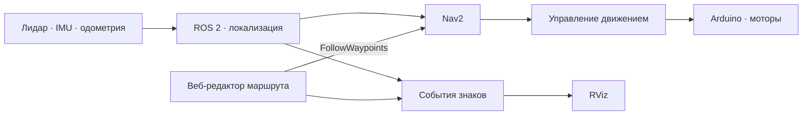

<div align="center">

# RTK CITY
### Автономный робот в городском полигоне

**🥈 2-е место · РТУ МИРЭА · 2026**  
Кубок РТК: Высшая лига · Задание «Движение по городу»


От карты и маршрута — к автономному движению, остановкам и парковке.

[О проекте](#о-проекте) · [Команда](#команда) · [Как это работает](#как-это-работает) · [Запуск](#запуск)

</div>

---

## 🥈 Результат

Наша команда заняла **2-е место на этапе «Кубка РТК: Высшая лига» в РТУ МИРЭА в 2026 году**. В этом репозитории собрано решение для городского полигона на базе мобильного робота **Frob**.

## Команда

| Участник |
| :--- |
| **Симакова Анастасия** |
| **Кулагин Александр** |
| **Голышев Юрий** |

## О проекте

**RTK CITY** — проект автономной навигации по модели городского квартала. Задача робота — пройти маршрут по полигону с перекрёстками и дорожными знаками, выполнить остановки для условной посадки пассажиров и завершить движение в зоне парковки.

Решение объединяет ROS 2, навигационный стек Nav2, данные лидара и одометрии, а также веб-интерфейс для подготовки маршрута. Оператор задаёт точки, остановки и знаки на карте, после чего робот проходит подготовленный маршрут.

### Что есть в решении

- **Редактор маршрута в браузере** — работа с картой, точками пути, остановками и знаками.
- **Движение через Nav2** — передача последовательностей точек в action `/follow_waypoints`.
- **Остановки между участками** — маршрут разбивается на группы точек с паузой 2 секунды между ними.
- **Отслеживание позиции** — положение робота поступает из `/amcl_pose` и отображается в интерфейсе.
- **Знаки как события на карте** — при приближении к заданной координате публикуется сообщение в `/signs`.
- **Визуализация в RViz** — дорожные знаки выводятся текстовыми маркерами через `/sign_marker`.
- **Сохранение сценария** — маршрут и окружение хранятся в JSON и могут загружаться повторно.

> В текущем городском сценарии знаки заранее расставляются на карте и срабатывают по позиции робота. Это позволяет воспроизводить маршрут с известным окружением.

## Как это работает



Веб-интерфейс построен на **Flask + Socket.IO** и связан с ROS 2-узлом `RobotPlannerNode`. Он отправляет маршрут в Nav2, публикует путь и остановки, отслеживает положение робота и активирует события дорожных знаков. Отдельный узел `SignDisplayNode` отвечает за отображение знаков в RViz.

## Технологии

| Компонент | Назначение |
| :--- | :--- |
| ROS 2 Jazzy | Обмен данными между узлами робота |
| Nav2 / AMCL | Навигация по карте и локализация |
| SLAM Toolbox | Построение карты |
| Python / C++ | Логика, интерфейс и ROS 2-пакеты |
| Flask / Socket.IO | Веб-редактор и обновления позиции |
| RViz | Визуализация робота, маршрута и знаков |
| Frob / Raspberry Pi / Arduino | Робототехническая платформа и управление моторами |

## Структура репозитория

```text
rtk-city/
├── Frob_gorod/
│   ├── GUI_path.py                 # Веб-редактор и отправка маршрута в Nav2
│   ├── signs_visualizer.py         # Дорожные знаки в RViz
│   ├── map.pgm                     # Карта полигона
│   ├── saved_path.json             # Сохранённые точки маршрута
│   ├── saved_environment.json      # Остановки и знаки
│   └── src/
│       ├── frob_bringup/           # Запуск оборудования
│       ├── frob_control/           # Управление движением
│       ├── frob_description/       # Описание робота и RViz
│       ├── frob_interfaces/        # Интерфейсы ROS 2
│       ├── frob_navigation/        # Nav2, SLAM, карты и настройки
│       ├── frob_odometry/          # Одометрия
│       ├── ros2_arduino_bridge/    # Связь с Arduino
│       └── …                      # Драйверы лидара, IMU и вспомогательные пакеты
└── README.md
```

## Запуск

Проект рассчитан на настроенную платформу Frob с **Ubuntu 24.04 и ROS 2 Jazzy**. Сборка и запуск требуют ROS 2-зависимостей пакетов, Nav2, SLAM Toolbox и подключённого оборудования. Инструкции по базовой платформе: [Frob_robot](https://github.com/dark516/Frob_robot).

### 1. Подготовить рабочее пространство

```bash
git clone https://github.com/fismay/rtk-city.git
cd rtk-city/Frob_gorod
source /opt/ros/jazzy/setup.bash
rosdep install --from-paths src --ignore-src -r -y
sudo apt install python3-flask python3-flask-socketio python3-pil python3-yaml
colcon build --symlink-install
source install/setup.bash
```

### 2. Настроить карту и оборудование

Перед запуском проверьте настройки портов, лидара, IMU и одометрии под свою конфигурацию Frob.

В `GUI_path.py`, в функции `load_hardcoded_map()`, замените значение `map_yaml_path` на абсолютный путь к своей карте, например к `Frob_gorod/src/frob_navigation/maps/map.yaml`. Карта редактора должна совпадать с картой, используемой Nav2. Параметры навигации находятся в `src/frob_navigation/config/nav2_params.yaml`.

### 3. Запустить узлы

В каждом терминале из каталога `Frob_gorod` подключите окружение:

```bash
source /opt/ros/jazzy/setup.bash
source install/setup.bash
```

Затем выполните команды в отдельных терминалах:

```bash
# Оборудование, описание робота и одометрия
ros2 launch frob_bringup bringup.launch.py

# Навигация по сохранённой карте
ros2 launch frob_navigation navigation.launch.py

# Веб-редактор маршрута
python3 GUI_path.py

# Визуализация знаков
python3 signs_visualizer.py
```

Откройте **http://localhost:5000** на компьютере, где запущен редактор, либо `http://<IP-робота>:5000` с устройства в той же сети. Задайте начальную позу робота в RViz, подготовьте или загрузите маршрут и окружение в веб-интерфейсе, затем передайте точки в планировщик.

В терминале `GUI_path.py`:

| Команда | Действие |
| :--- | :--- |
| `start` | Начать прохождение подготовленного маршрута |
| `restart` | Отменить текущую цель Nav2 и сбросить сценарий к первой группе точек |

Для отображения знаков добавьте в RViz **Marker** с топиком `/sign_marker`.

## Основа проекта

Репозиторий основан на [dark516/RTK_robot](https://github.com/dark516/RTK_robot) и выделяет городской сценарий в отдельный проект. Базовая платформа, её устройство и инструкции доступны в [dark516/Frob_robot](https://github.com/dark516/Frob_robot).

---

<div align="center">

**RTK CITY · РТУ МИРЭА · 2026**  
Симакова Анастасия · Кулагин Александр · Голышев Юрий

</div>
